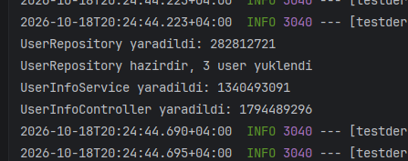
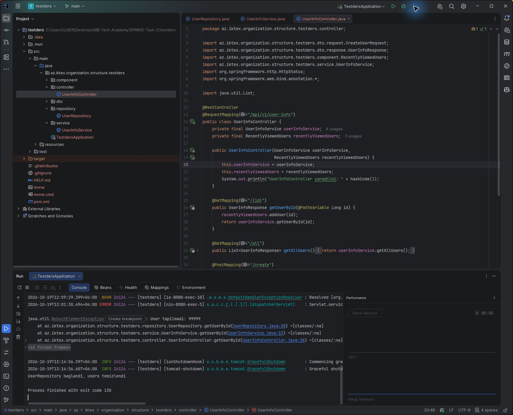
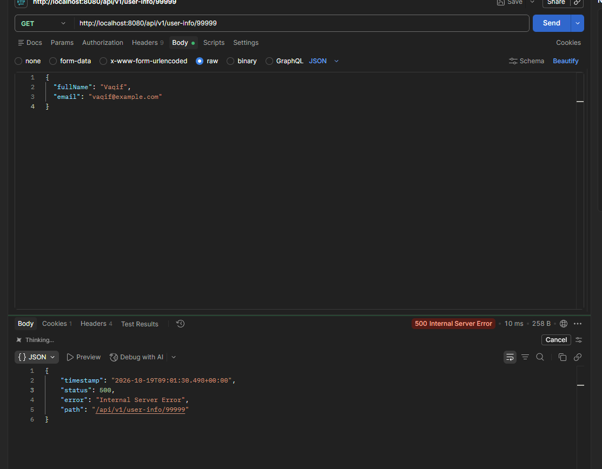
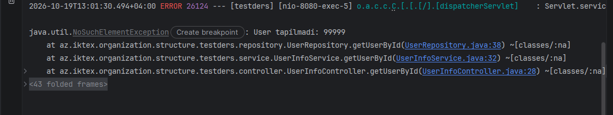
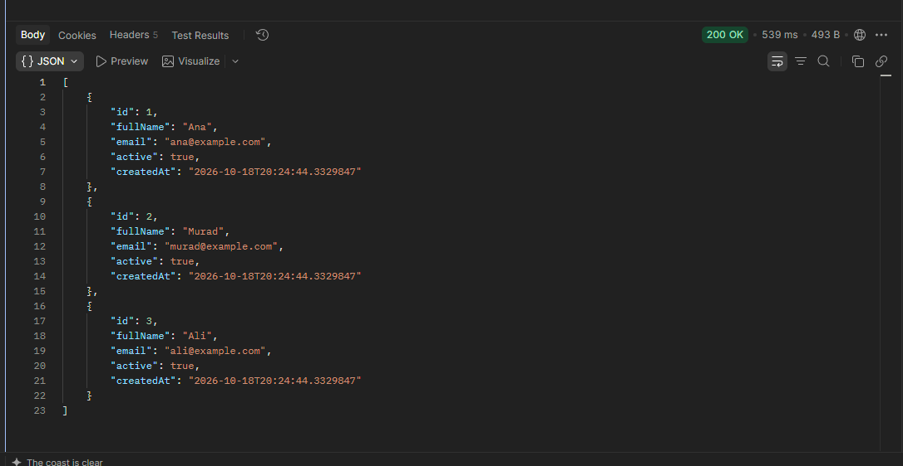
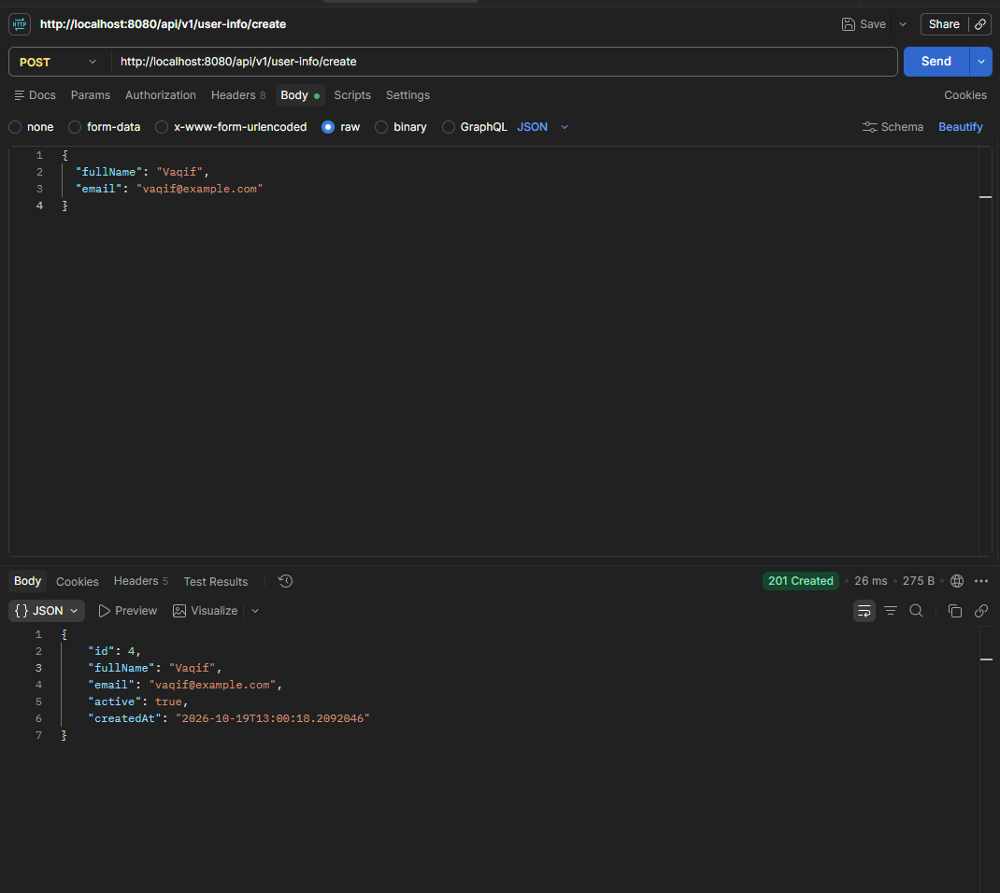

# SPRING-Task-2

Spring bean scope-ları və Dependency Injection tapşırığı. Hazırda 1-ci bölmə — singleton repository hazırlanıb və yoxlanıb. Arxivdən götürülən prototype, request və session nümunələri növbəti bölmələrdə tamamlanacaq.

## İşə salmaq

Maven layihəsi `testders` qovluğundadır. Spring Boot 3.5.16, Java target 17, Spring Web və Lombok istifadə olunur. Hazırkı yoxlamalar JDK 21-də aparılıb; ayrıca JDK 17 run-u edilməyib.

```powershell
cd testders
.\mvnw.cmd spring-boot:run
```

IntelliJ-də `testders/pom.xml` açıb Maven layihəsini yükləmək və `TestdersApplication` sinfini işə salmaq olar. Lombok üçün annotation processing aktiv olmalıdır. Standart port `8080`-dir.

```powershell
.\mvnw.cmd test
```

Mövcud avtomatik test `contextLoads`-dur. HTTP ssenariləri Postman ilə ayrıca yoxlanıb; bütün funksionallıq üçün unit-test coverage iddiası yoxdur.

## Endpointlər

| Metod | Yol | Nəticə |
| --- | --- | --- |
| GET | `/api/v1/user-info/all` | Bütün istifadəçilər |
| GET | `/api/v1/user-info/{id}` | ID ilə istifadəçi |
| POST | `/api/v1/user-info/create` | Yeni istifadəçi, 201 Created |

POST body:

```json
{
  "fullName": "Vaqif",
  "email": "vaqif@example.com"
}
```

## Bölmə 1 Singleton

### Tapşırıq 1 və 2

Məlumatlar `Map<Long, UserInfoResponse>` field-ində `ConcurrentHashMap` ilə saxlanılır. ID-lər `AtomicLong.incrementAndGet()` ilə ardıcıl verilir. Restart zamanı yaddaşdakı məlumatlar itir və başlanğıc istifadəçilər yenidən yüklənir.

### Tapşırıq 3

`@PostConstruct` Ana, Murad və Ali-ni yaradır. Konsola `UserRepository hazirdir, 3 user yuklendi` yazılır.



### Tapşırıq 4

`@PreDestroy` `users.clear()` çağırır və `UserRepository baglandi, users temizlendi` yazır. IntelliJ-də Stop zamanı mesaj görüldü. Qəfil proses/JVM dayanmasında callback zəmanətli deyil. Map-in təmizlənməsi burada lifecycle nümunəsidir.



### Tapşırıq 5

İstifadəçi yoxdursa `NoSuchElementException` atılır. `GET /99999` yoxlamasında konsolda `User tapilmadi: 99999` göründü. Exception handler olmadığına görə hazırda HTTP 500 qaytarılır, 404 deyil.



Şəkildə əvvəlki POST-un body-si qalıb; GET axtarış metodu onu istifadə etmir. Təkrar yoxlamada GET üçün Body → none seçilməlidir.



### Tapşırıq 6

Controller, service və repository konstruktorlarına `yaradildi` və `hashCode()` log-u əlavə etdim. Tətbiq başladıqda hər biri bir dəfə yaradıldı. 10 təkrar sorğudan sonra konstruktor mesajları yenidən çıxmadı. Sorğular eyni singleton bean-lərdən istifadə edir. Təkrar sorğu nəticəsi müşahidə ilə yoxlanıb; ayrıca 10 sorğulu run screenshot-u yoxdur. `hashCode()` yaddaş ünvanı deyil və unikal olmasına zəmanət yoxdur.

### Tapşırıq 7

Başlanğıc `GET /all` üç istifadəçi qaytardı. `POST /create` ilə Vaqif yaradıldı və ID 4 alındı. Sonrakı `GET /4` həmin istifadəçini qaytardı. 19 oktyabr təkrar HTTP yoxlamasında eyni email və createdAt təsdiqləndi, sonrakı `/all` siyahısında 4 istifadəçi oldu. 10 əlavə GET sorğusu da 4 istifadəçi qaytardı. Bu təkrar yoxlama müvəqqəti 8081 portunda aparılıb; layihənin standart portu dəyişdirilməyib. Ayrıca GET screenshot-u yoxdur; aşağıdakı `/all` şəkli yaradılmadan əvvəlki üç istifadəçini göstərir.





### Tapşırıq 8

Singleton bean-i eyni anda bir neçə thread istifadə edə bilər. Dəqiq say serverin imkanlarından və gələn sorğulardan asılıdır; scope thread sayını məhdudlaşdırmır. Lokal dəyişənlər və parametrlər hər çağırış üçün ayrıdır, bean-in field-ləri isə ortaqdır. Lokal istinadlar ortaq dəyişən obyektə yönəlsə, həmin obyekt yenə paylaşılır.

Adi `HashMap` paralel dəyişikliklər üçün təhlükəsiz deyil. Adi `long` üzərində `++` atomik olmadığından iki thread eyni ID ala bilər. `ConcurrentHashMap` map əməliyyatları üçün, `AtomicLong` isə ID artımı üçün istifadə olunur. Bir neçə əməliyyatdan ibarət ardıcıllıq və `UserInfoResponse` field-lərinin dəyişdirilməsi ayrıca thread-safety tələb edə bilər.

## Hesabat

Birinci bölmənin cavabları və ekran görüntüləri ayrıca [Word hesabatında](docs/Singleton-hesabat.docx) da var. README-dəki cavablar və screenshot-lar tapşırığın təhvil qaydasını saxlayır.
