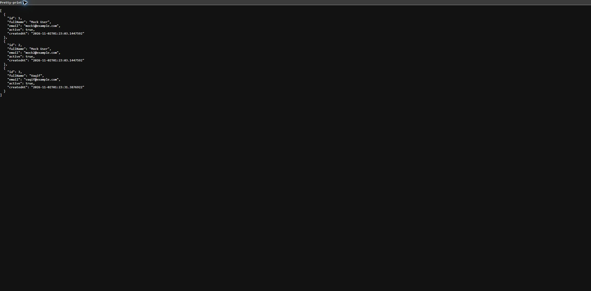
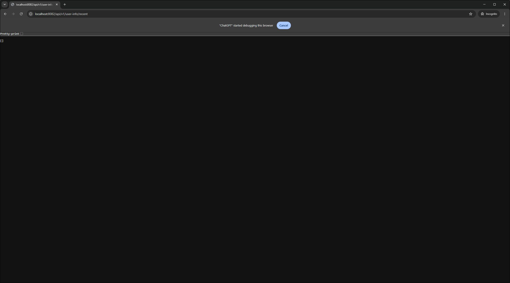
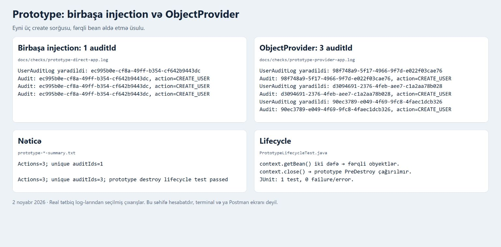
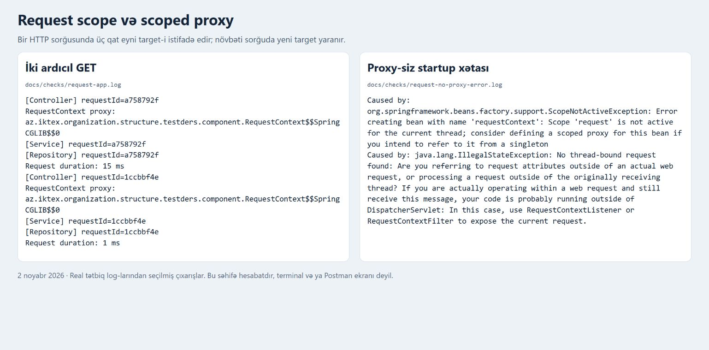
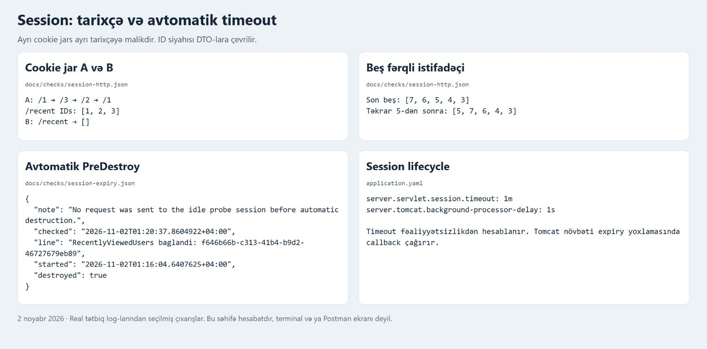
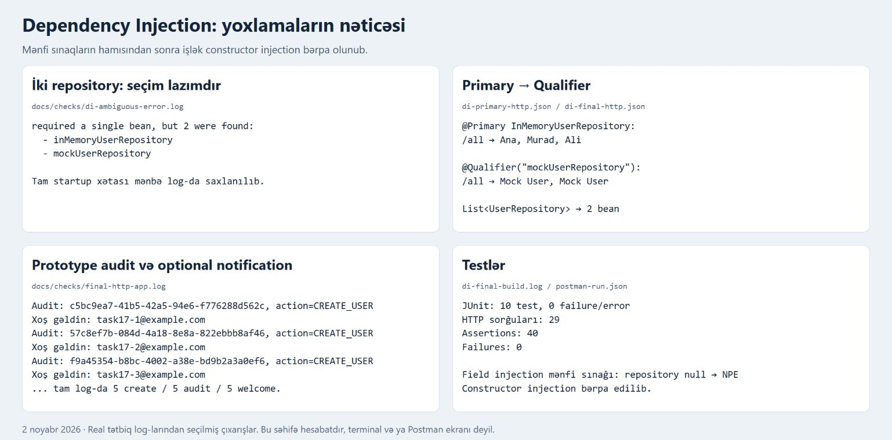
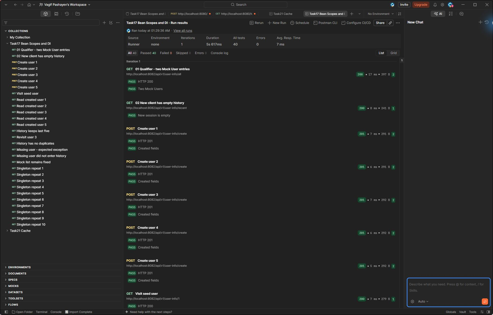

# SPRING-Task-2

Spring bean scope-ları və Dependency Injection tapşırığı. Bölmələr üzrə nəticələr aşağıda saxlanılır.

## İşə salmaq

Maven layihəsi `testders` qovluğundadır. Spring Boot 3.5.16, Java target 17, Spring Web və Lombok istifadə olunur. Hazırkı yoxlamalar JDK 21-də aparılıb; ayrıca JDK 17 run-u edilməyib.

```powershell
cd testders
.\mvnw.cmd spring-boot:run
```

IntelliJ-də `testders/pom.xml` açıb Maven layihəsini yükləmək və `TestdersApplication` sinfini işə salmaq olar. Lombok üçün annotation processing aktiv olmalıdır. Standart port `8080`-dir.

```powershell
.\mvnw.cmd test
```

JUnit yoxlamaları: prototype lifecycle, session tarixçəsi, repository seçimi, Spring context və Spring-siz service testləri.
HTTP yoxlamalarının nəticələri `docs/checks` qovluğundadır. Verilənlər yalnız RAM-da saxlanır; Docker və DB lazım deyil.

8080 məşğuldursa:

```powershell
.\mvnw.cmd package
java -jar target/testders-0.0.1-SNAPSHOT.jar --server.port=8082
```

Son DI mərhələsində Tapşırıq 29-a görə `mockUserRepository` seçilib. `/all` həmişə iki `Mock User` qaytarır.
Mock-da POST ilə yaradılan user öz ID-si ilə GET-də tapılır, amma sabit demo `/all` siyahısına əlavə edilmir.
Əvvəlki singleton/session mərhələlərinin tam in-memory variantı Git tarixçəsində saxlanılıb.

## Endpointlər

| Metod | Yol | Nəticə |
| --- | --- | --- |
| GET | `/api/v1/user-info/all` | Bütün istifadəçilər |
| GET | `/api/v1/user-info/{id}` | ID ilə istifadəçi |
| POST | `/api/v1/user-info/create` | Yeni istifadəçi, 201 Created |
| GET | `/api/v1/user-info/recent` | Cari session-da son beş fərqli istifadəçi |

POST body:

```json
{
  "fullName": "Vaqif",
  "email": "vaqif@example.com"
}
```

## Bölmə 1 Singleton

### Tapşırıq 1 və 2

Məlumatlar `Map<Long, UserInfoResponse>` field-ində `ConcurrentHashMap` ilə saxlanılır. ID-lər `AtomicLong.incrementAndGet()` ilə ardıcıl verilir. Restart zamanı yaddaşdakı məlumatlar itir və başlanğıc istifadəçilər yenidən yüklənir.

### Tapşırıq 3

`@PostConstruct` Ana, Murad və Ali-ni yaradır. Konsola `UserRepository hazirdir, 3 user yuklendi` yazılır.


### Tapşırıq 4

`@PreDestroy` `users.clear()` çağırır və `UserRepository baglandi, users temizlendi` yazır. IntelliJ-də Stop zamanı mesaj görüldü. Qəfil proses/JVM dayanmasında callback zəmanətli deyil. Map-in təmizlənməsi burada lifecycle nümunəsidir.


### Tapşırıq 5

İstifadəçi yoxdursa `NoSuchElementException` atılır. `GET /99999` yoxlamasında konsolda `User tapilmadi: 99999` göründü. Exception handler olmadığına görə hazırda HTTP 500 qaytarılır, 404 deyil.


Şəkildə əvvəlki POST-un body-si qalıb; GET axtarış metodu onu istifadə etmir. Təkrar yoxlamada GET üçün Body → none seçilməlidir.


### Tapşırıq 6

Controller, service və repository konstruktorlarına `yaradildi` və `hashCode()` log-u əlavə etdim. Tətbiq başladıqda hər biri bir dəfə yaradıldı. 10 təkrar sorğudan sonra konstruktor mesajları yenidən çıxmadı. Sorğular eyni singleton bean-lərdən istifadə edir. Təkrar sorğu nəticəsi müşahidə ilə yoxlanıb; ayrıca 10 sorğulu run screenshot-u yoxdur. `hashCode()` yaddaş ünvanı deyil və unikal olmasına zəmanət yoxdur.

### Tapşırıq 7

Başlanğıc `GET /all` üç istifadəçi qaytardı. `POST /create` ilə Vaqif yaradıldı və ID 4 alındı. Sonrakı `GET /4` həmin istifadəçini qaytardı. 19 oktyabr təkrar HTTP yoxlamasında eyni email və createdAt təsdiqləndi, sonrakı `/all` siyahısında 4 istifadəçi oldu. 10 əlavə GET sorğusu da 4 istifadəçi qaytardı. Bu təkrar yoxlama müvəqqəti 8081 portunda aparılıb; layihənin standart portu dəyişdirilməyib. Ayrıca GET screenshot-u yoxdur; aşağıdakı `/all` şəkli yaradılmadan əvvəlki üç istifadəçini göstərir.


### Tapşırıq 8

Singleton bean-i eyni anda bir neçə thread istifadə edə bilər. Dəqiq say serverin imkanlarından və gələn sorğulardan asılıdır; scope thread sayını məhdudlaşdırmır. Lokal dəyişənlər və parametrlər hər çağırış üçün ayrıdır, bean-in field-ləri isə ortaqdır. Lokal istinadlar ortaq dəyişən obyektə yönəlsə, həmin obyekt yenə paylaşılır.

Adi `HashMap` paralel dəyişikliklər üçün təhlükəsiz deyil. Adi `long` üzərində `++` atomik olmadığından iki thread eyni ID ala bilər. `ConcurrentHashMap` map əməliyyatları üçün, `AtomicLong` isə ID artımı üçün istifadə olunur. Bir neçə əməliyyatdan ibarət ardıcıllıq və `UserInfoResponse` field-lərinin dəyişdirilməsi ayrıca thread-safety tələb edə bilər.

## Bölmə 2 Prototype

### Tapşırıq 9 və 10

UserAuditLog prototype bean-dir: auditId UUID, createdAt LocalDateTime, action isə setter ilə təyin olunur.
Konstruktor hər yaradılmanı və auditId-ni log-a yazır.

### Tapşırıq 11 və 12

Əvvəl UserAuditLog singleton UserInfoService konstruktoruna birbaşa inject edildi. Üç POST/create eyni auditId-ni istifadə etdi:
Spring asılılığı service yaradılarkən bir dəfə verdi. Sonra ObjectProvider istifadə edildi;
hər createUser çağırışı getObject ilə yeni audit alır və CREATE_USER action təyin edir.
[Birbaşa injection log-u](docs/checks/prototype-direct-app.log), [HTTP](docs/checks/prototype-direct-http.json).

### Tapşırıq 13

Prototype bean üçün Spring yaradılma və initialization mərhələlərini idarə edir, amma avtomatik destroy callback saxlamır.
Context bağlananda UserAuditLog-un PreDestroy log-u çıxmır. Resurs varsa onu istifadə edən kod təmizləməlidir.
PrototypeLifecycleTest bunu ayrıca yoxlayır.

### Provider yoxlaması

[Üç fərqli auditId log-u](docs/checks/prototype-provider-app.log), [HTTP cavabları](docs/checks/prototype-provider-http.json).

## Bölmə 3 Request

### Tapşırıq 14 və 15

RequestContext request scope-dadır: UUID-dən 8 simvol requestId və millisecond startTime saxlayır.
Controller, service, repository konstruktorları eyni scoped proxy-ni qəbul edir.

### Tapşırıq 16 və 17

Bir GET/id zamanı üç qat eyni requestId-ni log-a yazır. Növbəti GET yeni requestId alır.
Controller cavab qaytarmazdan əvvəl cari vaxtdan startTime çıxıb müddəti millisecond ilə yazır;
bu, context ilk istifadə olunandan hesablanan vaxtdır, tam şəbəkə round-trip ölçüsü deyil.

### Tapşırıq 18 və 19

RequestScope əvəzinə proxy-siz Scope("request") sınağında startup ScopeNotActiveException verdi:
singleton yaradılarkən aktiv HTTP request yoxdur. Sonra RequestScope bərpa edildi.
[Real startup xətası](docs/checks/request-no-proxy-error.log).
RequestScope default olaraq TARGET_CLASS proxy istifadə edir. getClass çıxışında $$SpringCGLIB$$ görünür.
Proxy singleton-da qalır, method çağırışını cari HTTP request-in həqiqi obyektinə ötürür.

## Bölmə 4 Session

### Tapşırıq 20–22

RecentlyViewedUsers session scope-dadır. Son 5 fərqli ID saxlanır, ən yeni əvvəldədir.
TəkrarID əvvəlki yerindən çıxıb əvvələ keçir. synchronized metodlar eyni session-dan paralel
sorğuları qoruyur; getUsers dəyişdirilməyən snapshot qaytarır.
Uğurlu getUserById-dən sonra ID əlavə olunur. Tapılmayan user tarixçəyə düşmür.
/recent service vasitəsilə ID-ləri tam UserInfoResponse-a çevirir.

### Tapşırıq 23

application.yaml-da server.servlet.session.timeout: 1m qoyulub.
Tomcat background yoxlaması üçün background-processor-delay: 1s istifadə olunur;
session dəqiq 60-cı saniyədə deyil, container-in növbəti expiry yoxlamasında silinə bilər.
PreDestroy zamanı tarixçə təmizlənir və bean-in ID-si log-a yazılır.
[Session HTTP yoxlamaları](docs/checks/session-http.json), [expiry nəticəsi](docs/checks/session-expiry.json),
[log](docs/checks/session-app.log).

### Tapşırıq 24

Eyni cookie ilə /1,/3,/2,/1 → /recent nəticəsi ID 1,2,3 olan tam user-lərdir.
Ayrı cookie jar-da /recent boşdur. Chrome və incognito ayrıca JSESSIONID saxlayır;
Postman da Chrome-un cookie-sini avtomatik götürmür, ona görə tarixçəsi boş ola bilər.
Cookie-ni silmək və ya session müddətinin bitməsi yeni tarixçə yaradır.

### Tapşırıq 25

Bu field request scope-da olsaydı hər yeni HTTP sorğusunda yeni siyahı yaranardı.
Əvvəlki /1 sorğusunun tarixçəsi sonrakı /recent sorğusuna qalmazdı.
Session scope bir istifadəçinin bir neçə sorğusu arasında vəziyyəti saxlayır.
## Bölmə 5 Dependency Injection

### Tapşırıq 26

UserRepository indi üç metodlu interface-dir: getUserById, getAllUsers, createUser.
Əvvəlki storage və lifecycle kodu InMemoryUserRepository-yə köçürülüb.
Service interface-dən asılıdır; hansı implementasiyanı istifadə etdiyini özü yaratmır.

### Tapşırıq 27

İkinci implementasiya MockUserRepository-dir. /all həmişə adı Mock User olan iki nümunə qaytarır.
Hər iki bean var, amma seçim yoxdursa startup dayanır: expected single matching bean but found 2.
Bu, UnsatisfiedDependencyException daxilində NoUniqueBeanDefinitionException səbəbidir;
RepositorySelectionTest də həmin exception tipini yoxlayır.
[Startup xətası](docs/checks/di-ambiguous-error.log).

### Tapşırıq 28 və 29

Əvvəl InMemoryUserRepository üzərinə @Primary qoyuldu: /all Ana, Murad və Ali qaytardı.
Sonra @Primary silindi, service konstruktorunda @Qualifier("mockUserRepository") seçildi.
İndi /all iki Mock User qaytarır. @Primary ümumi üstünlükdür, @Qualifier konkret injection nöqtəsində seçimi daraldır.
[Primary nəticəsi](docs/checks/di-primary-http.json), [Qualifier nəticəsi](docs/checks/di-final-http.json).

### Tapşırıq 30 və 31

NotificationService.sendWelcome(String email) optional setter ilə inject olunur:
@Autowired(required = false). Implementasiya olmadan tətbiq açıldı və POST/create uğurlu oldu
([HTTP](docs/checks/di-primary-http.json)). Bu setter Tapşırıq 30-un ayrıca tələbidir;
məcburi asılılıqlar final field və constructor ilə verilir.
Sonra @Service ConsoleNotificationService əlavə edildi. createUser uğurla saxlanandan sonra
Xoş gəldin: email log-u yazılır. Bu, həqiqi email göndərilməsi deyil.
[Final welcome log-u](docs/checks/final-http-app.log).

### Tapşırıq 32

UserInfoServiceTest Spring açmadan Mockito mock-ları və new UserInfoService ilə işləyir.
Müvəqqəti sınaqda repository field üzərinə @Autowired qoyuldu, constructor assignment silindi.
Test constructor-a mock versə də, field onu almırdı: plain new Spring injection işə salmır.
Bu səbəbdən repository null qaldı və testlər NullPointerException ilə dayandı.
Sonra final field + constructor assignment bərpa edildi, clean test package uğurlu oldu.
[Sınağın xəta log-u](docs/checks/di-field-injection-error.log), [düzəldilmiş build](docs/checks/di-final-build.log).
Constructor injection asılılığı açıq göstərir, final field istifadə etməyə və Spring-siz test yazmağa imkan verir.

### Tapşırıq 33

Service konstruktorunda List<UserRepository> iki element aldı: InMemoryUserRepository və MockUserRepository.
Tək repository parametrindəki @Qualifier siyahıya tətbiq olunmur; siyahı bütün uyğun bean-ləri alır.
Startup log-u: Repository sayi: 2. Siyahının sırasına güvənilmir.

## Şifahi müdafiə

- IoC: obyektlərin yaradılması və lifecycle idarəsi container-ə verilir. DI: asılılıqların obyektə kənardan ötürülməsidir;
  IoC-ni tətbiq etməyin bir yoludur. DI Spring olmadan da mümkündür.
- Constructor injection: asılılıqlar görünür, final field mümkündür, unit test üçün container lazım deyil.
- Prototype üçün container avtomatik PreDestroy çağırmır; lazım olan cleanup istifadə edən kodun məsuliyyətidir.
- Request bean singleton-a proxy vasitəsilə verilir. Proxy hər çağırışda cari request-in target obyektini tapır.
- Session scope bir HTTP session üçün tarixçə/səbət saxlaya bilər. Application scope ServletContext üzrə ortaqdır,
  məsələn bütün istifadəçilərin statistikasını saxlayır. Ortaq dəyişən state yenə thread-safe olmalıdır.
- Konkret @Qualifier ilə seçim daraldılır; uyğun gəlməyən @Primary bu seçimi əvəz etmir.

## Əhatə

Məcburi 1–33 tapşırıqları yerinə yetirilib. 34–37 ayrıca, məcburi olmayan bonus bölməsidir və bu versiyaya əlavə edilməyib.
Tapşırıq üzrə gözlənən NoSuchElementException üçün ayrıca handler əlavə olunmayıb; olmayan ID HTTP500 verir.

## Son yoxlamalar

2 noyabr 2026: clean test package — 10 JUnit testi, 0 failure/error.
Postman v2.1 kolleksiyasının Newman6.2.3 run-u: 29 HTTP sorğusu, 40 assertion, 0 failure.
10 təkrar GET zamanı singleton constructor log-ları yenidən çıxmadı.
Beş create üçün beş fərqli auditId və beş welcome mesajı oldu.
[Kolleksiya](docs/postman/Task17.postman_collection.json), [run log-u](docs/checks/postman-run.log),
[JSON nəticə](docs/checks/postman-run.json), [constructor/audit nəticəsi](docs/checks/final-log-summary.json).

Postman-da kolleksiyanı import edib Run ilə işə salmaq olar; baseUrl standart olaraq8082-dir.
Yeni cookie jar istifadə edin; uzun fasilədə1dəqiqəlik session bitə bilər.
Nəticələr konkret ssenariləri yoxlayır, bütün mümkün hallara zəmanət deyil.



Incognito-da ilk /recent ayrıca session yaratdı və boş siyahı qaytardı.



## Şəkillər və əlavə hesabat

Aşağıdakı dörd şəkil real log-lardan hazırlanmış HTML hesabat səhifələridir;
terminal və Postman interfeysinin şəkli kimi təqdim olunmur. İlkin mənbələr `docs/checks`-dədir.









Aşağıdakı şəkil isə tətbiqin özündə icra olunmuş Postman runner-dir:40 pass,0 fail.



## Hesabat

Birinci bölmənin cavabları və ekran görüntüləri ayrıca [Word hesabatında](docs/Singleton-hesabat.docx) da var. README-dəki cavablar və screenshot-lar tapşırığın təhvil qaydasını saxlayır.
